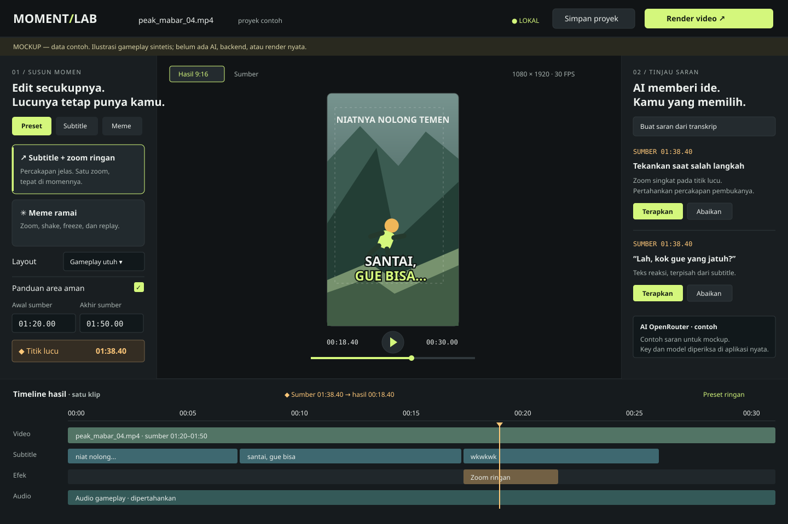

# Gaming Funny Moments Web App — Implementation Plan

> **For agentic workers:** REQUIRED SUB-SKILL: Use superpowers:subagent-driven-development (recommended) or superpowers:executing-plans to implement this plan task-by-task. Steps use checkbox (`- [ ]`) syntax for tracking. Jika skill tersebut tidak tersedia, kerjakan berurutan dalam sesi yang sama dengan checkpoint dan bukti; jangan mengklaim telah menjalankan skill yang tidak tersedia. Dokumen ini merencanakan pekerjaan, bukan bukti bahwa aplikasi telah dibuat.

**Goal:** Membuat aplikasi web lokal untuk memilih momen dari video gameplay 3–5 menit, meninjau subtitle/saran AI, dan merender MP4 9:16 melalui dua preset Remotion.

**Architecture:** Next.js App Router menyediakan editor React dan API Route Handlers pada satu origin lokal. Worker Node persisten menjalankan pekerjaan FFmpeg, OpenRouter, dan render Remotion dari job snapshot di disk; tidak menggantungkan pekerjaan panjang pada lifecycle HTTP atau hot reload Next.js. Satu kontrak edit dan compiler timeline dipakai oleh preview/render; AI hanya mengusulkan data tervalidasi yang ditinjau pengguna.

**Tech Stack:** Node 24 LTS, Next.js App Router, React, TypeScript, npm, shadcn/ui + Base UI + Tailwind CSS, Lucide React, Emoji Mart, Twemoji, Fontsource/local font files, Motion for React, Zod, Remotion/Player/Bundler/Renderer, FFmpeg/FFprobe, OpenRouter HTTP API, Busboy streaming upload, Vitest, React Testing Library, dan pengujian browser. Noto/Lottie opsional setelah pipeline dasar terbukti.

---

## 1. Keputusan, batas, dan kondisi awal

- Root: `E:\Remotion`. Proyek saat ini hanya berisi dokumen dan Git; belum ada aplikasi, package.json, atau node_modules.
- Pengguna meminta plan dan mockup; jangan mulai menginstal dependensi atau membangun aplikasi ketika hanya menjalankan permintaan dokumen ini.
- Sumber utama: `docs/superpowers/specs/2026-10-12-gaming-funny-moments-design.md` dan `docs/research/2026-10-12-frontend-ui-references.md`. Bagian input pada spesifikasi lama diperbarui oleh keputusan terbaru: dukung sumber 3–5 menit dan pilih rentang di aplikasi.
- Node terdeteksi `24.15.0`, Python default `3.14.5`, FFmpeg dan FFprobe tersedia di PATH, RAM sekitar 27.7 GiB, GPU RTX 3050 Laptop 6 GB. Kinerja dan kompatibilitas GPU belum diuji. Pemeriksaan runtime tersebut adalah snapshot saat plan awal ditulis; tidak membuktikan integrasi AI cloud. Python/GPU model lokal tidak diperlukan pada plan yang diperbarui.
- Keputusan pengguna terbaru: gunakan Next.js, bukan frontend build tool pada plan lama; OpenRouter adalah satu-satunya provider AI aplikasi, termasuk speech-to-text. Tidak memasang model lokal atau Python transkripsi. Rendering/FFmpeg tetap berjalan pada perangkat lokal.
- Satu sumber, satu rentang, satu titik lucu, dan satu MP4 per proyek. Pengguna dapat membuat proyek baru dari sumber yang sama; batch extraction tidak termasuk versi pertama.
- Sumber 180–300 detik wajib terbukti bekerja; durasi bukan batas keras 300 detik. Batas input versi pertama 2 GiB, media harus terbaca. UI menjelaskan batas sebelum memilih file.
- Output tetap 1080 × 1920, 30 FPS, H.264/AAC. Tidak memasang login, billing, cloud storage, remote URL import, atau auto-posting.
- Nama UI sementara: **Moment Lab**, boleh diganti tanpa mengubah arsitektur.
- SRT/manual dan render lokal tetap berfungsi ketika API key, internet, kredit, atau model OpenRouter tidak tersedia. Status AI tidak boleh disamarkan sebagai berhasil lewat data contoh. Permintaan AI menggunakan jaringan dan dapat dikenai biaya; jangan menjalankan permintaan berbayar hanya saat membuka proyek.

## 2. Mockup dan kontrak desain

**Buka [mockup interaktif](../../mockups/editor.html)**. Ini prototipe HTML mandiri, bukan frontend produksi. Semua data contoh dan aksi simulasi dilabeli; tidak ada upload, AI, atau render nyata.

### Preview mockup



### Asal keputusan UI

| Sumber | Pola yang diambil | Adaptasi |
|---|---|---|
| [Reelio](https://dribbble.com/shots/26984097-AI-Short-Video-Editor-for-Creators) | Preview vertikal pusat, tools kiri, saran kanan | Dua preset; tombol Terapkan/Abaikan per saran |
| [ClipPilot](https://dribbble.com/shots/27106290-ClipPilot-AI-Video-Editor-Dashboard) | Workspace gelap dan panel AI | Charcoal dengan satu aksen lime; status lokal terlihat |
| [Orizon](https://dribbble.com/shots/22315456-Video-Editor-Web-Application) | Properti teks serta track terpisah | Track Video, Subtitle, Efek, Audio; tanpa editor multitrack bebas |
| [Remotion demo](https://editor-starter.remotion.dev/) | Empty canvas, playback, export | Pilih video sumber dan output 9:16; bukan keputusan membeli Editor Starter |

### Tata ruang

```text
┌ Moment Lab │ nama proyek │ status lokal │ Simpan │ Render ┐
│ Preset / Subtitle / Meme │ Hasil 9:16 / Sumber │ Saran AI │
│ Dua preset              │ Preview pusat      │ Terapkan │
│ Layout + crop focus     │ Playback + seek    │ Abaikan  │
│ Awal / Akhir / Titik    │ Durasi hasil       │ API/key  │
├ Timeline hasil · sumber 01:38.40 → hasil 00:18.40         ┤
│ Video       [rentang gameplay]                           │
│ Subtitle    [dialog 1] [dialog 2]                         │
│ Efek                     ◆ [zoom / replay]               │
│ Audio       [audio sumber / aset efek suara]             │
└──────────────────────────────────────────────────────────┘
```

- Desktop ≥1200 px: tools 286 px, preview fleksibel, AI 304 px; header 68 px; timeline 210–260 px. Panel memakai scroll internal agar preview tetap terlihat pada laptop 1366 × 768.
- 900–1199 px: panel AI di bawah editor dengan section yang dapat ditutup; preview dan kontrol sumber tetap terlihat.
- <900 px: preview, tools, AI, timeline ditumpuk; tidak ada overflow halaman. Penyuntingan nyaman di desktop, tetapi kontrol tetap dapat diakses dari mobile.
- Tokens: background `#111416`, panel `#191e21`, border `#30383c`, text `#EDF1EE`, muted `#A9B4B1`, accent `#D4F77C`, subtitle track `#79CDD0`, moment marker `#FFC879`.
- Font dipilih dari riset toolkit: Barlow400/500/600 untuk UI, Barlow700/800 untuk caption, Barlow Condensed800 untuk reaksi singkat, IBM Plex Mono400/500 untuk timestamp. Berkas berlisensi OFL disimpan lokal; Next memakai next/font/local, Remotion memuat berkas yang sama dan menunggu font siap. Jangan mengimpor next/font ke bundle video.
- Caption paling banyak dua baris; aturan pemecahan baris adalah pembungkusan/layout teks yang ditinjau, bukan klaim diarization. Warna pembicara hanya dari label yang diisi pengguna.
- Panduan area aman: default 80 px kiri, 180 px kanan, 160 px atas, 320 px bawah pada kanvas 1080 × 1920; bisa disembunyikan di preview dan tidak masuk render. Ini margin produk konservatif, bukan jaminan semua versi UI TikTok/Shorts.

### States yang wajib dibangun

| State | Perilaku |
|---|---|
| Empty | Pilih video lokal; sumber 3–5 menit dijelaskan; Render disabled |
| Importing | Progres byte dari upload lokal, tombol disabled, kegagalan disk jelas |
| Media incompatible | Bedakan codec preview dari media rusak; tawarkan proxy/transcode lokal |
| Editing | Source seek terpisah dari output preview; awal/akhir/titik tervalidasi |
| Unsaved | Status belum tersimpan dan peringatan sebelum pindah proyek |
| Transcribing | Job berjalan, bisa dibatalkan, edit manual yang baru tidak ditimpa |
| AI unavailable | Missing key, jaringan, kredit, atau capability model dijelaskan; manual/SRT tersedia |
| Suggestions ready | Tiap saran punya waktu, tindakan, Terapkan/Abaikan |
| Before AI request | Tampilkan model, jenis data yang dikirim, dan estimasi biaya bila tersedia; tombol eksplisit Jalankan |
| Rendering | Snapshot revisi terlihat; progress nyata dan Batalkan |
| Complete | Lokasi output lokal dan Unduh/Buka hasil; bukan progres simulasi |
| Failed/cancelled | Pesan yang dapat ditindaklanjuti; sumber/proyek tetap aman |

## 2a. Toolkit UI yang masuk cakupan implementasi

Riset sumber: [UI libraries lengkap](../../research/2026-10-12-ui-libraries-fonts-emoji-motion.md). Pilihan pengguna terbaru menjadi authority untuk Next.js/OpenRouter; halaman riset sebelumnya adalah snapshot pencarian, bukan alasan mempertahankan stack lama.

| Bagian | Pilihan | Task dan aturan |
|---|---|---|
| UI | shadcn/ui + Base UI + Tailwind |1,8,9,12; pilih source components minimum dan sesuaikan tokens, bukan template dashboard generik |
| Icons | Lucide React |8,9; import per ikon dan label aksesibel |
| Emoji picker | Emoji Mart dengan bundled data |9; lazy load, custom label Indonesia bila dibutuhkan |
| Render emoji | Twemoji aset lokal |6,9; manifest Unicode graphemes, fallback terlihat, graphics CC BY4.0 |
| Font | Barlow, Barlow Condensed, IBM Plex Mono |1,6,8; OFL notices, local Next font loader dan Remotion loader terpisah |
| UI motion | Motion for React + native hover CSS |8,12; reduced motion; tidak berada dalam composition video |
| Video motion | Remotion interpolate/Easing/spring |3,6; frame driven, deterministik |
| Sticker animasi opsional | Noto animated + @remotion/lottie |Setelah13; curated JSON lokal + attributionCC BY4.0, parity test sebelum adopsi |

Mantine/OpenMoji tetap alternatif yang sudah dibandingkan, bukan dependency paralel. Tidak menambah GSAP bila helper Remotion/Motion sudah mencukupi. Asset emoji/font dan ukuran subtitle harus diuji pada footage asli.

## 2b. Best practice resmi Remotion yang wajib diterapkan

| Pedoman resmi | Implementasi konkret | Bukti |
|---|---|---|
| [Agent Skills](https://www.remotion.dev/docs/ai/skills) | Pada build pasang project-scoped Remotion skills: `rtk proxy npx skills add remotion-dev/skills`; pilih remotion-best-practices/markup/captions/render/saas yang relevan. Baca SKILL sebelum dipakai. Ini panduan coding agent, bukan plugin provider AI runtime |Task1 setup log dan review source |
| [Coding agents](https://www.remotion.dev/docs/ai/coding-agents) | Agent bekerja dengan preview proyek dan instruksi konkret; tidak menilai visual dari kompilasi saja |Task6/9/13 preview dan rendered frame inspection |
| [LLM generation](https://www.remotion.dev/docs/ai/generate) | Keluaran runtime berupa data edit strictJSON +Zod, bukan React source. Structured output memvalidasi bentuk; timing/isi masih diperiksa |Task2/11 schema/range/error tests |
| Prompt dan context | System prompt pendek; muat pengetahuan relevan pada build, jangan seluruh docs per panggilan. Pada runtime kirim hanya selected transcript/range/preset, bukan history chat atau seluruh rekaman |Task10/11 payload test |
| [Animating properties](https://www.remotion.dev/docs/animating-properties) | useCurrentFrame untuk semua animasi video; interpolate+Easing untuk zoom/fade, spring hanya bounce/physics yang diminta. Jangan CSS transitions/timer/Math.random bebas dalam MP4 |Task3/6 deterministic frames + no-flicker inspection |
| Preview lalu render | Satu komposisi dan compiler dipakai Player/Renderer, schema edit tervalidasi sebelum keduanya, font/aset siap sebelum render |Task6/9/13 parity proof |

Remotion tidak mewajibkan Next.js atau OpenRouter; keduanya keputusan pengguna. Contoh resmi AI SDK adalah contoh integrasi, bukan kewajiban memasang Vercel AI SDK. HTTP fetch native cukup untuk satu provider kita; model IDs dari contoh docs tidak otomatis menjadi pilihan produk.

## 2c. Data flow lokal dan cloud

```text
Browser editor → Next Route Handler → job snapshot lokal
                                  → Node worker
                                    ├ FFmpeg / Remotion → MP4 lokal
                                    ├ audio rentang → OpenRouter STT → proposal subtitle
                                    └ selected transcript → OpenRouter chat → proposal efek
```

Video sumber/media/proyek/output tetap lokal. Audio rentang dan transcript yang dipakai AI keluar ke OpenRouter beserta provider model; UI menandai aksi ini sebagai online sebelum klik. Tidak ada upload seluruh video otomatis, permintaan AI pada health/open-project, atau klaim all-local. Manual/SRT/render dapat berjalan offline setelah dependencies/assets tersedia.

Dokumentasi OpenRouter yang dibaca: [Quickstart](https://openrouter.ai/docs/quickstart), [Structured outputs](https://openrouter.ai/docs/guides/features/structured-outputs), [Speech-to-text](https://openrouter.ai/docs/guides/overview/multimodal/stt). STT timestamp support bervariasi per model/provider dan harus dibuktikan; jangan membuat subtitle timing palsu bila hanya teks tersedia.

## 3. Struktur file dan kepemilikan

```text
src/
  app/ layout.tsx page.tsx globals.css error.tsx loading.tsx
    api/ health/route.ts assets/route.ts
      assets/[id]/content/route.ts assets/[id]/preview/route.ts
      projects/route.ts projects/[id]/route.ts
      projects/[id]/transcribe/route.ts projects/[id]/suggestions/route.ts
      projects/[id]/render/route.ts jobs/[id]/route.ts
      jobs/[id]/cancel/route.ts outputs/[id]/route.ts
  shared/ edit.ts timeline.ts presets.ts suggestions.ts
  components/ui/               # source shadcn yang digunakan saja
  web/ api.ts fonts.ts
    editor/ Editor.tsx SourcePlayer.tsx OutputPreview.tsx RangeControls.tsx
    editor/ PresetPanel.tsx SubtitlePanel.tsx AssetPanel.tsx SuggestionPanel.tsx
    editor/ EmojiPicker.tsx OutputTimeline.tsx RenderDialog.tsx useProject.ts
  video/ index.ts Root.tsx FunnyMoment.tsx VideoSegment.tsx CaptionLayer.tsx
    EffectLayer.tsx AudioLayer.tsx EmojiLayer.tsx load-fonts.ts
  server/ guard.ts storage.ts assets.ts media.ts projects.ts jobs.ts
    render.ts openrouter.ts transcribe.ts process.ts env.ts
  worker/ index.ts
scripts/ doctor.mjs create-fixture.mjs smoke-render.mjs verify-assets.mjs
tests/ edit.test.ts timeline.test.ts security.test.ts projects.test.ts
  ai.test.ts jobs.test.ts editor.test.tsx render.integration.test.ts
public/ fonts/ emoji/             # aset bawaan trusted, dengan manifest dan lisensi
.data/ assets/ projects/ jobs/ outputs/ tmp/ locks/  # diabaikan Git
docs/ SETUP.md TESTING.md
package.json package-lock.json tsconfig.json next.config.ts next-env.d.ts
components.json postcss.config.mjs vitest.config.ts .gitignore .env.example
```

`server/*` hanya diimpor Route Handlers atau worker, tidak oleh Client Components. Enforce boundary dengan lint/import tests dan `server-only` pada entry yang diimpor Next; worker mengimpor helper Node yang tidak bergantung kondisi export `server-only`. OpenRouter API key hanya dibaca di sisi server/worker.

Next menjadi pemilik API dan penyajian UI; worker tidak membuka public API dan bukan server Express tambahan. Komunikasi melalui job files atomic dengan lock filesystem agar module isolation/hot reload Next tidak mengandalkan singleton memori untuk concurrency. Tidak membuat generic multi-provider interface untuk satu provider OpenRouter.


## 4. Kontrak data dan waktu

### Kontrak inti yang dibuat pada Task 2

```ts
// src/shared/edit.ts — seluruh timestamp canonical dalam frame 30 FPS.
export const FPS = 30;
export type Preset = 'light' | 'meme';
export type Asset = {
  id: string; kind: 'video' | 'image' | 'audio'; name: string;
  durationFrames: number; width: number; height: number;
  hasAudio: boolean; previewReady: boolean;
};
export type Caption = {
  id: string; startFrame: number; endFrame: number; text: string;
  speaker: string | null;
};
export type Effect = {
  id: string; kind: 'zoom' | 'shake' | 'reaction' | 'image' | 'sfx';
  startFrame: number; endFrame: number; text: string;
  assetId: string | null; strength: number;
};
export type Edit = {
  id: string; revision: number; assetId: string; name: string;
  startFrame: number; endFrame: number; momentFrame: number;
  preset: Preset; layout: 'contain' | 'crop';
  focusX: number; focusY: number; captionY: number;
  freezeFrames: number; replayFrames: number;
  captions: Caption[]; effects: Effect[];
};
export type Segment = {
  kind: 'normal' | 'freeze' | 'replay'; sourceStart: number;
  sourceEnd: number; outputStart: number; durationFrames: number;
};
export type CompiledEdit = {
  segments: Segment[]; durationFrames: number;
  captions: Caption[]; effects: Effect[];
};
export const toFrame = (seconds: number) => Math.round(seconds * FPS);
```

`sourceEnd` dan seluruh `endFrame` eksklusif. `momentFrame` harus `< endFrame`. Waktu asli video dipetakan berdasarkan detik, bukan menganggap fps rekaman sama dengan composition fps. Semua UI detik menjadi integer frame sebelum disimpan. Metadata duration dibulatkan ke bawah untuk mencegah frame di luar media.

### Timeline deterministik

Misal `s=startFrame`, `e=endFrame`, `p=momentFrame`, `f=freezeFrames`, `r=replayFrames`. Replay mencakup jendela `[max(s,p-floor(r/3)), min(e, start+r))`, diputar ulang segera setelah jendela aslinya selesai. Freeze disisipkan sebelum frame `p`, lalu playback asli dilanjutkan dari `p`, sehingga tidak membuang audio/video sumber.

```ts
// Algoritme lengkap untuk pembentukan segment; validasi dilakukan sebelum masuk.
export function buildSegments(s: number, e: number, p: number, f: number, r: number) {
  const list: Segment[] = [];
  let output = 0;
  const add = (kind: Segment['kind'], a: number, b: number, length = b - a) => {
    if (length <= 0) return;
    list.push({kind, sourceStart: a, sourceEnd: b,
      outputStart: output, durationFrames: length});
    output += length;
  };
  const a = Math.max(s, p - Math.floor(r / 3));
  const b = Math.min(e, a + r);
  add('normal', s, p);
  add('freeze', p, p + 1, f);
  add('normal', p, Math.max(p, b));
  if (r > 0) add('replay', a, b);
  add('normal', Math.max(p, b), e);
  return {segments: list, durationFrames: output};
}
```

Compiler memotong setiap caption/effect terhadap setiap normal/replay segment, mengubah offset ke output, dan menghasilkan ID `${id}:${segmentIndex}`. Pada freeze, caption yang aktif pada `p` bertahan; audio sumber diam. Reaksi dan SFX hanya dipicu pada kejadian asli kecuali pengguna sengaja menambahkan efek lain. Caption dialog diulang pada replay. Hindari soundtrack gameplay ganda pada layer background blur.

Contoh bukti: sumber `[2400,3300)` (01:20–01:50), titik 2952 (01:38.40), freeze 12, replay 36 menghasilkan output 948 frame =31.6 detik. Titik kejadian playback asli menjadi frame 564 setelah freeze; posisi awal freeze 552. UI menampilkan kedua makna secara eksplisit saat diperlukan.

### Preset tetap

| Nilai | light | meme |
|---|---|---|
| Zoom | 1.12×, 18 frame sekitar titik | 1.30×, 24 frame |
| Shake | off | amplitudo maksimum 8 px kanvas, 10 frame |
| Freeze | off | 12 frame, pengguna dapat mematikan |
| Replay | off | off sampai dipilih; default saat dipilih 36 frame |
| Reaksi | off sampai teks diberikan | aktif hanya jika teks diberikan |
| Audio sumber | gain 1.0 | gain 1.0 |
| SFX aset | opsional; gain default 0.35 | opsional; gain default 0.35 |

Nilai ini default desain, belum hasil uji selera. Pergantian preset tidak menghapus caption atau aset pengguna; tawarkan Terapkan default efek sebelum mengganti efek yang telah dikoreksi.

## 5. API lokal dan penyimpanan

Next dev dan production bind `127.0.0.1:3000`; UI dan API satu origin. Worker berjalan sebagai proses Node terpisah, tanpa port layanan tambahan. Deployment awal adalah proses lokal yang persisten, bukan Edge/serverless hosting. Set `runtime = "nodejs"` pada media/job Route Handlers; dynamic GET job/project/media memakai `Cache-Control: no-store`. Dynamic route params di-await (`Promise<{id:string}>`).

| Method / route | Request | Response / perilaku |
|---|---|---|
| GET `/api/health` | — | Versi, readiness FFmpeg/worker, dan status konfigurasi OpenRouter tanpa membocorkan key; panggilan model tidak dijalankan saat health check |
| POST `/api/assets` | Multipart satu file | 201 Asset; stream ke staging, validasi, lalu publish |
| GET `/api/assets/:id/content` | Range header opsional | Media stream 200/206; 416 bila range salah |
| POST `/api/assets/:id/preview` | — | 202 job membuat proxy H.264/AAC untuk preview bila dibutuhkan |
| GET `/api/projects` | — | Daftar ringkas proyek lokal |
| POST `/api/projects` | `{assetId,name}` | 201 Edit dengan default valid |
| GET `/api/projects/:id` | — | Edit dan revision |
| PUT `/api/projects/:id` | Edit + `If-Match` revision | 200 revision baru; 409 bila stale |
| POST `/api/projects/:id/transcribe` | `{revision}` | 202 Job; hanya selected range diekstrak |
| POST `/api/projects/:id/suggestions` | `{revision}` | 202 Job; model berasal dari konfigurasi server yang tervalidasi |
| POST `/api/projects/:id/render` | `{revision}` | 202 Job, snapshot edit yang sudah tersimpan |
| GET `/api/jobs/:id` | — | Job status, progress bila tersedia, error, hasil |
| POST `/api/jobs/:id/cancel` | — | Request cancellation idempotent |
| GET `/api/outputs/:id` | — | MP4 selesai saja; attachment header dengan nama aman |

`Job` mempunyai `id`, `kind` (`proxy/transcribe/suggestions/render`), `status` (`queued/running/succeeded/failed/cancelled/interrupted`), `projectId`, `revision`, `progress: number|null`, `createdAt`, `result`, dan `error:{code,message}|null`. Persentase hanya bila tersedia dari proses; transkripsi/AI dapat menampilkan indeterminate.

Satu worker persisten menjalankan paling banyak satu job aktif; lock eksklusif mencegah dua worker mengambil job yang sama. Request Next hanya memvalidasi, menulis job snapshot atomic, dan mengembalikan202; worker membaca job baru, menjalankan proses, serta menulis status/progress. Cancel memakai marker job-specific dan AbortController yang diamati worker. Request render duplikat atas revisi yang sama mengembalikan job aktif yang sama; request berat lain dapat ditolak 409 BUSY versi pertama. Tidak perlu queue distributif.

Proyek disimpan sebagai JSON tervalidasi. Job snapshot tidak berisi credential; worker memperoleh key dari env pada saat eksekusi. Source manifest dan asset URLs dikelola server tanpa secret OpenRouter. Save menggunakan lockfile per proyek yang lintas-proses, write-temp + rename di direktori yang sama, serta revision compare di dalam lock. Gagal rename Windows harus dilaporkan tanpa menghapus file lama. UI mempunyai tombol Simpan, indikator dirty, serta peringatan keluar; render menyimpan dahulu dan hanya berjalan jika save berhasil. Tidak memakai database untuk satu pengguna lokal.

## 6. Tahapan implementasi dan bukti

Semua perintah shell memakai `rtk` sesuai `C:\Users\daffa\.codex\RTK.md`. Potongan kode pada task adalah isi kontrak/helper/tes yang dipakai untuk mengunci perilaku; file UI/backend lain dibangun dari kontrak dan acceptance steps yang eksplisit. Plan tidak menyamar sebagai seluruh source aplikasi yang telah diimplementasikan.

### Task 1 — Next.js scaffold, worker, toolkit, dan runtime

**Files:** create `package.json`, `package-lock.json`, `tsconfig.json`, `next.config.ts`, `postcss.config.mjs`, `components.json`, `vitest.config.ts`, `.gitignore`, `.env.example`, `scripts/doctor.mjs`, `src/app/layout.tsx`, `page.tsx`, `globals.css`, `src/worker/index.ts`, `src/server/env.ts`.

- [x] Periksa `rtk node --version`, `rtk npm --version`, `rtk ffmpeg -version`, `rtk ffprobe -version`. Jangan memasang transkripsi Python/model lokal.
- [x] Gunakan create-next-app dalam staging sibling/temporary directory, App Router/TypeScript/Tailwind, lalu pindahkan hanya scaffold yang diperiksa ke root; pertahankan `docs` dan `.git`. Jangan menjalankan scaffold destruktif terhadap direktori nonempty.
- [x] Paket utama setelah scaffold:

```powershell
rtk npm install remotion @remotion/player @remotion/bundler @remotion/renderer zod busboy lucide-react motion emoji-mart @emoji-mart/data @emoji-mart/react @twemoji/api @fontsource/barlow @fontsource/barlow-condensed @fontsource/ibm-plex-mono
rtk npm install -D tsx concurrently vitest jsdom @testing-library/react @testing-library/user-event @testing-library/jest-dom @types/busboy
rtk proxy npx shadcn@latest init
rtk proxy npx shadcn@latest add button tabs dialog alert-dialog slider switch select popover tooltip progress scroll-area resizable input textarea badge
```

- [x] Pilih Base UI pada shadcn setup, mapping import `@/*` dan lokasi `src/components/ui`; jangan mencampur Radix/komponen duplikat. CLI flags/current API harus diperiksa sebelum eksekusi. Semua paket Remotion pin exact release yang sama dan commit lockfile.
- [x] Scripts:

```json
{"dev":"concurrently -k \"next dev --hostname 127.0.0.1 --port 3000\" \"tsx --env-file=.env.local src/worker/index.ts\"",
 "typecheck":"tsc --noEmit",
 "test":"vitest run",
 "build":"next build",
 "start":"concurrently -k \"next start --hostname 127.0.0.1 --port 3000\" \"tsx --env-file=.env.local src/worker/index.ts\"",
 "doctor":"node scripts/doctor.mjs",
 "fixture":"node scripts/create-fixture.mjs",
 "smoke:render":"node scripts/smoke-render.mjs",
 "verify:assets":"node scripts/verify-assets.mjs"}
```

- [x] `.env.local` dibuat pengguna dari example; tidak berisi key di Git. Example fields: `OPENROUTER_API_KEY`, `OPENROUTER_SUGGESTION_MODEL`, `OPENROUTER_TRANSCRIPTION_MODEL`. Tidak ada key berprefiks `NEXT_PUBLIC_`. Worker memuat env yang sama melalui Node env-file; Next membaca `.env.local` otomatis. Readiness mengecek configured/unconfigured tanpa memanggil API berbayar.
- [x] `.gitignore` mencakup `.next`, `node_modules`, `.data`, `.env*` kecuali `.env.example`, test outputs. `next.config.ts` mengexternal-kan paket renderer/bundler yang membutuhkan filesystem sesuai dukungan versi terpasang; jangan mengirim dependency renderer ke browser.
- [x] Layout/page menjadi Server Components; editor/Player/emoji picker menjadi Client Components. Props lintas boundary berupa DTO serializable saja. `error.tsx` memiliki error UI yang dapat dicoba ulang; `loading.tsx` tidak memblokir worker.
- [x] Fontsource menyediakan file font berlisensi; copy fixed weights ke `public/fonts` dengan manifest/hash/notices. Next UI memakai `next/font/local`, video memakai file sama melalui loader Remotion. Aset emoji static dibundle lokal; tidak fetch CDN saat render.
- [x] Run typecheck/build, expected exit0; worker idle dapat dihentikan bersih. Commit `chore: scaffold Next editor and persistent local worker`.


### Task 2 — Skema edit, preset, dan validasi

**Files:** create `src/shared/edit.ts`, `presets.ts`, `suggestions.ts`, `tests/edit.test.ts`.

- [x] Tulis tes berikut sebelum validator. Export fungsi `validateEdit(edit, asset, relatedAssets)` dari `edit.ts`; kembalikan parsed Edit atau throw validation error.

```ts
import {expect, test} from 'vitest';
import {validateEdit, type Asset, type Edit} from '../src/shared/edit';
const asset: Asset = {id:'a',kind:'video',name:'clip.mp4',durationFrames:7560,
 width:1920,height:1080,hasAudio:true,previewReady:true};
const edit: Edit = {id:'p',revision:1,assetId:'a',name:'Mabar',startFrame:2400,
 endFrame:3300,momentFrame:2952,preset:'light',layout:'contain',focusX:.5,
 focusY:.5,captionY:.72,freezeFrames:0,replayFrames:0,captions:[],effects:[]};
test('accepts selected range within a 4m12s source',()=>{
 expect(validateEdit(edit,asset,[]).endFrame).toBe(3300);
});
test.each([NaN,Infinity,-1,3300])('rejects invalid moment %s',momentFrame=>{
 expect(()=>validateEdit({...edit,momentFrame},asset,[])).toThrow();
});
test('rejects nonexistent meme asset',()=>{
 expect(()=>validateEdit({...edit,effects:[{id:'e',kind:'image',startFrame:2952,
 endFrame:2982,text:'',assetId:'missing',strength:1}]},asset,[])).toThrow();
});
```

- [x] `rtk npm test -- tests/edit.test.ts`: expected fail until validator exists.
- [x] Implement Zod strict objects from section 4: finite integer frames, nonempty bounded IDs, name ≤120 chars, caption ≤160 chars, reaction ≤80 chars, normalized focus 0..1, captionY .15.. .82, freeze 0..60, replay 0..90, zoom strength 1..1.5, shake ≤12 px; at most 600 captions and 100 effects. Reject unknown keys. Refine source range against metadata and asset type against relatedAssets. Enforce caption start < end and effect start < end.
- [x] Add `makePresetEffects(preset, momentFrame, startFrame, endFrame)` which clips its window to selected range. It generates no reaction text or arbitrary assets. Preset default changes require explicit UI action when existing effects differ.
- [x] Rerun tests; expected pass. Commit `feat: define validated editing contract`.

### Task 3 — Compiler timeline sebagai sumber kebenaran

**Files:** create `src/shared/timeline.ts`, `tests/timeline.test.ts`; modify `edit.ts` if typed compiler result needed.

- [x] Tulis tes real mapping berikut; export `compileEdit(Edit):CompiledEdit` dan `sourceFrameAt(CompiledEdit,outputFrame):number`.

```ts
import {expect,test} from 'vitest';
import {compileEdit,sourceFrameAt} from '../src/shared/timeline';
import type {Edit} from '../src/shared/edit';
const edit: Edit = {id:'p',revision:1,assetId:'a',name:'x',startFrame:2400,
 endFrame:3300,momentFrame:2952,preset:'meme',layout:'contain',focusX:.5,
 focusY:.5,captionY:.72,freezeFrames:12,replayFrames:36,effects:[],
 captions:[{id:'c',startFrame:2952,endFrame:2960,text:'jatuh',speaker:null}]};
test('freeze/replay preserve selected source length and align captions',()=>{
 const result=compileEdit(edit);
 expect(result.durationFrames).toBe(948);
 expect(sourceFrameAt(result,552)).toBe(2952);
 expect(sourceFrameAt(result,563)).toBe(2952);
 expect(sourceFrameAt(result,564)).toBe(2952);
 expect(result.captions.some(c=>c.startFrame===564)).toBe(true);
 expect(sourceFrameAt(result,947)).toBe(3299);
});
test('no insertions maps first/last frame exactly',()=>{
 const r=compileEdit({...edit,freezeFrames:0,replayFrames:0});
 expect(r.durationFrames).toBe(900);
 expect(sourceFrameAt(r,0)).toBe(2400);
 expect(sourceFrameAt(r,899)).toBe(3299);
});
```

- [x] Run failing test, then implement `buildSegments` from section 4 and interval intersection mapping. `sourceFrameAt` finds half-open output interval, returns freeze sourceStart or sourceStart+offset; invalid output frame throws.
- [x] Add boundary cases: moment at start, moment=end-1, replay shorter near end, captions crossing cuts, source without audio, disabled effects. Assert segment continuity and sum durations with seeded generated valid ranges.
- [x] Run `rtk npm test -- tests/timeline.test.ts`; expected pass. Commit `feat: compile source edits into one output timeline`.

### Task 4 — Local trust boundary, media import, and streaming

**Files:** create `src/server/guard.ts`, `storage.ts`, `process.ts`, `media.ts`, `assets.ts`, `src/app/api/assets/route.ts`, `tests/security.test.ts`.

- [x] Tests assert unexpected Host, cross-site Origin mutation, `../` ID, invalid UUID, oversized upload, fake MIME, and invalid Range are rejected; valid same-origin upload returns managed Asset.
- [x] Validate Host against `127.0.0.1:3000` dan Origin yang sama pada Route Handlers. Tidak percaya forwarded headers dari klien; deployment hanya loopback pada versi pertama. Mutations require allowed Origin plus JSON or multipart content type. CORS does not use wildcard. Reject cross-site Fetch Metadata. Bind to loopback; localhost tools cannot execute arbitrary shell commands.
- [x] Gunakan Busboy dengan stream Node dari `Readable.fromWeb(request.body)` untuk menulis file ke staging, limit2GiB, tepat satu file, bounded fields, filename UUID. Jangan `request.formData()`/`arrayBuffer()` untuk memuat video2GiB ke RAM dan jangan gunakan Server Action untuk upload besar. Detect truncated limit and remove only known staging file inside `.data/tmp`. Probe media with FFprobe, not extension/MIME alone. Filenames are display text, never shell strings or storage paths.
- [x] Use this process pattern, with caller-provided fixed arguments and trusted executable names only:

```ts
import {spawn} from 'node:child_process';
export function spawnTool(command: string, args: string[]) {
 return spawn(command,args,{shell:false,windowsHide:true,
  stdio:['ignore','pipe','pipe']});
}
```

- [x] `runTool` wraps it with bounded stdout/stderr, timeout, AbortSignal, exit checks, and child-tree cancellation on Windows. Never log private transcripts or full local paths by default.
- [x] FFprobe args `-v error -show_format -show_streams -of json <managedPath>`; duration finite positive; reject media with no video for video import. Images limited 25 MiB and decoded dimension ≤8192; audio ≤100 MiB and valid audio stream. Reject SVG/HTML/script inputs as meme assets.
- [x] Media IDs map through manifest lookup, not user path joins. Stream Range with validated single interval, Content-Type from probe, Content-Length, Accept-Ranges, and safe Content-Disposition. Reject multiple ranges in first version.
- [x] On unsupported browser codec, preserve original and create local preview proxy: H.264 yuv420p/AAC with max 1280 px longest side, native timestamps, faststart. A lower-quality preview proxy must not become final-render source. Final render uses original only if renderer can decode it; otherwise explicit full-quality normalized intermediate. Maintain source duration/frame alignment across proxies.
- [x] Route media mengembalikan Web ReadableStream dengan no-store; Route Handlers params di-await dan runtime Node. API integration tests memakai server Next nyata pada port tes yang diizinkan dan temp data root. Upload besar diuji melalui chunk-stream dengan batas memori terukur.
- [x] Run `rtk npm test -- tests/security.test.ts`; expected all rejection/streaming cases pass. Commit `feat: import and serve managed local media safely`.

### Task 5 — Proyek lokal dan save concurrency

**Files:** create `src/server/projects.ts`, `tests/projects.test.ts`; extend `storage.ts`.

- [x] Test that source import + create project survives restart, two concurrent saves with revision 1 yield exactly one revision 2 and one 409, malformed stored JSON returns readable error, rename failure preserves previous file.
- [x] Store project `${uuid}.json` with strict Edit; metadata manifests separately. Lock per project around read revision, validate, stage, and rename. Temp name UUID in same directory. Gunakan lockfile filesystem eksklusif yang dibagikan Next dan worker; cek revision di dalam lock. Tidak cukup memakai singleton Map yang dapat berbeda antar module/worker atau hot reload. Stale lock hanya dilepas setelah PID pemilik terbukti mati; jangan paksa melepas lock proses aktif.
- [x] GET list returns ID/name/updatedAt/source name only. PUT requires `If-Match`; return revision 2 with persisted content. No automatic deletion endpoints in first version.
- [x] Run `rtk npm test -- tests/projects.test.ts`; expected pass. Commit `feat: persist versioned local projects`.

### Task 6 — Remotion composition dan local render smoke

**Files:** create `src/video/index.ts`, `Root.tsx`, `FunnyMoment.tsx`, `VideoSegment.tsx`, `CaptionLayer.tsx`, `EffectLayer.tsx`, `AudioLayer.tsx`, `scripts/create-fixture.mjs`, `scripts/smoke-render.mjs`, `tests/render.integration.test.ts`.

- [x] Create synthetic fixture with FFmpeg lavfi: 300 seconds, 1280×720, 30fps, colored timecoded pattern and 440 Hz audio. Add 1-second distinct tone near point 98.4s for sync verification; no real user footage committed. Store fixture under `.data/tmp`.
- [x] Register composition with dynamic duration from `compileEdit`:

```tsx
import React from 'react';
import {Composition,getInputProps,registerRoot} from 'remotion';
import {FunnyMoment,type VideoProps} from './FunnyMoment';
import {compileEdit} from '../shared/timeline';
export const Root=()=> <Composition id="FunnyMoment" component={FunnyMoment}
 width={1080} height={1920} fps={30} durationInFrames={1}
 defaultProps={getInputProps<VideoProps>()}
 calculateMetadata={({props})=>({durationInFrames:compileEdit(props.edit).durationFrames})}/>;
registerRoot(Root);
```

`VideoProps` is `{edit:Edit,sourceUrl:string,assetUrls:Record<string,string>}`; validate before composition. Root reads validated inputProps supplied by the backend/smoke runner; an empty Studio entry must show an instructional composition rather than dereferencing an absent edit. Separate registration (`index.ts`) from Root export so web importing composition does not call registerRoot.

- [x] Each segment uses `Sequence from={outputStart} durationInFrames={durationFrames}`. Original/replay Video component uses source trim in composition frame units. Freeze uses `<Freeze frame={0}>` around a video trimmed at sourceStart and muted. Use the current pinned Remotion component API; check installed type signatures before coding, do not mix deprecated props.
- [x] Keep source audio in exactly one layer; blur background video always muted. Freeze segment muted. SFX tracks use managed asset URLs and bounded volume. Preview and render import same FunnyMoment.
- [x] Draw contain/crop using shared focusX/Y; deterministic zoom interpolation; shake from fixed frame-based sine function, never Math.random per frame. Reaction uses text nodes; no innerHTML. Caption text wraps to max two lines in safe area with measured font and accessible editor adjustment. Export excludes safe-area guides.
- [x] Renderer smoke uses `bundle` once, `selectComposition({id:'FunnyMoment',inputProps})`, then `renderMedia({codec:'h264',audioCodec:'aac',crf:18,pixelFormat:'yuv420p',composition,inputProps,serveUrl,outputLocation})`. Start concurrency 2 and benchmark before increasing; do not promise GPU hardware encoding.
- [x] Run `rtk npm run fixture`, then `rtk npm run smoke:render`. FFprobe output asserts 1080×1920, fps 30, H.264, AAC, 30.0s light and 31.6s meme when freeze12/replay36 enabled. Inspect selected first/moment/replay/last frames and listen to audio interruption/replay. Commit `feat: render both presets from shared composition`.

### Task 7 — Job lifecycle, render snapshot, cancel, recovery

**Files:** create `src/server/jobs.ts`, `render.ts`, `src/worker/index.ts`, `tests/jobs.test.ts`; create render/job/cancel Route Handlers yang tercantum di struktur file.

- [x] Test duplicate render requests reuse active job, another heavy job yields BUSY, revision mutation after start does not change snapshot, cancelled output is not downloadable, restart marks running jobs interrupted.
- [x] Save a deep immutable edit snapshot and revision in job JSON before work begins. Job ID determines output and temp names. Backend owns statuses; frontend cannot set success or outputPath.
- [x] Bundle cache invalidated by source/version changes; run worker with fixed FFmpeg/runtime dependencies. Forward progress from renderer only; use its cancellation API where available. Cancel child processes and polling cleanly, then delete only that job's managed partial output after process closure.
- [x] Atomic rename final MP4 after renderer success and probe verification. `/api/outputs/:id` verifies succeeded job and mapped output, never serves partial file. Preserve failed job diagnostic code without raw stack exposure.
- [x] Poll while UI has running jobs every 1s; stop on terminal state/unmount. On restart discover persisted jobs and preserve finished outputs. Commit `feat: coordinate recoverable local render jobs`.

### Task 8 — Frontend shell, source range, and project controls

**Files:** create `src/app/page.tsx`, `layout.tsx`, `globals.css`, `error.tsx`, `src/web/api.ts`, `editor/Editor.tsx`, `SourcePlayer.tsx`, `RangeControls.tsx`, `useProject.ts`, `tests/editor.test.tsx`.

- [x] Translate mockup ke semantic Next Client Components dengan shadcn Base UI, Tailwind tokens, dan Lucide; retain responsive rules. Remotion Player dimuat client-side; jika SSR-nya bermasalah, dynamic import dengan ssr:false hanya dari Client Component. Emoji Mart lazy-load pada Popover, termasuk data lokal. Do not copy simulated script or hardcoded success into production UI. Create project picker, empty state, local upload, actual filename and metadata.
- [x] SourcePlayer uses browser video, supports keyboard seek, and emits `currentTime`. Buttons Ambil awal/Ambil akhir/Tandai update draft canonical frame values. Numeric timestamp inputs offer precise control; selecting a point outside range produces clear validation, not silent movement.
- [x] useProject owns draft, persisted revision, dirty, save state and server errors. A 409 prompts reload/copy draft; no automatic overwrite. Render first awaits successful save, then starts job for returned revision.
- [x] API client uses relative `/api`, parses structured errors, AbortController for requests, and aborts polling on unmount. No external network URLs in user inputs.
- [x] Editor test: source duration 252s, chosen [80,110), moment98.4 produces frames2400/3300/2952; invalid end disables Render. Failed save prevents render POST.
- [x] Run `rtk npm test -- tests/editor.test.tsx`, `rtk npm run typecheck`. Commit `feat: edit one selected moment in local web UI`.

### Task 9 — Preview, timeline, presets, caption/SRT editing, assets

**Files:** create `OutputPreview.tsx`, `OutputTimeline.tsx`, `PresetPanel.tsx`, `SubtitlePanel.tsx`, `AssetPanel.tsx`, `EmojiPicker.tsx`, `src/video/EmojiLayer.tsx`, `load-fonts.ts`; modify editor/timeline tests dan asset manifest.

- [x] OutputPreview receives `VideoProps` used by render and mounts Remotion Player with compiler duration. Source and output tabs have independent time positions; selected mode is announced through tab roles.
- [x] Timeline displays compiled output intervals (not raw source times) and source/output tooltips. One point marker identifies start of freeze and actual event frame when different. Click caption/effect selects existing item; no arbitrary layer editor needed.
- [x] Implement preset select with explicit apply-defaults action preserving captions/custom assets. Controls include freeze/replay toggles, bounded zoom/shake, contain/crop, normalized focus controls, caption position, and safe-guide preview toggle.
- [x] Subtitle editor supports add/update/delete segment, speaker label, text, timestamps; source canonical frame domain displayed explicitly. Import SRT locally as text, parse timestamps with milliseconds, reject invalid overlaps if simultaneous cues cannot fit, clip cues outside selection with a count/message. Offer time base choice Source or Selected clip for imported SRT; selected-clip times offset by startFrame. Export SRT reflects selected source range before inserted effects, labelled accordingly.
- [x] Emoji Mart memilih Unicode grapheme; Twemoji trusted SVG/PNG lokal memakai manifest yang sama di UI/video. Test skin tone, ZWJ family, flags, variation selectors, dan emoji yang tidak tersedia; tidak memakai innerHTML parser. Pastikan dataset picker dan Twemoji kompatibel walau Unicode version berbeda. Kredit graphicsCC BY4.0 dan fontOFL ikut NOTICE/credit output yang sesuai.
- [x] Motion for React hanya pada shell: dialog180ms, panel120–160ms, apply feedback160ms; reduced motion mematikan bounce/pergeseran besar. Video tetap useCurrentFrame; Noto + @remotion/lottie opsional, bukan paket wajib atau upload JSON arbitrer.
- [x] Meme image/audio uploads use assets route and require supported type. Pick stored assets for effect entry, display volume/duration; default has no unlicensed stock meme.
- [x] Test manual corrections persist through preset change and preview uses edited text; imported SRT offset by startFrame; unknown asset rejected. Browser check desktop 1440, laptop1366×768, mobile390px; no horizontal overflow. Commit `feat: preview and refine captions presets and assets`.

### Task 10 — Transkripsi lewat OpenRouter speech-to-text

**Files:** create `src/server/openrouter.ts`, `transcribe.ts`, `env.ts`, `tests/ai.test.ts`, `docs/SETUP.md`; extend worker/jobs dan transcribe Route Handler.

- [x] Model dipilih dari `GET /api/v1/models?output_modalities=transcription`; validasi model slug yang dikonfigurasi dan capability endpoint. Jangan memakai model chat biasa untuk mengarang timestamp. Uji dukungan `verbose_json` dan segment/word timestamps pada model/provider nyata sebelum mengaktifkan subtitle otomatis.
- [x] Worker mengekstrak hanya selected range sebagai mono16kHz WAV lewat FFmpeg. Split menjadi chunk maksimal30detik untuk mengurangi timeout/ukuran, with optional small overlap yang dideduplikasi berdasarkan timestamp+teks. Jangan mengirim rekaman sumber penuh atau filepath lokal.
- [x] Panggil endpoint resmi STT melalui server/worker dengan payload berikut; model berasal env server, bukan request klien:

```ts
const payload = {
  model: process.env.OPENROUTER_TRANSCRIPTION_MODEL,
  input_audio: {data: audioBytes.toString('base64'), format: 'wav'},
  language: 'id', response_format: 'verbose_json',
  timestamp_granularities: ['segment', 'word']
};
const response = await fetch('https://openrouter.ai/api/v1/audio/transcriptions', {
  method:'POST', headers:{'Content-Type':'application/json',
    Authorization:`Bearer ${process.env.OPENROUTER_API_KEY}`},
  body:JSON.stringify(payload), signal
});
```

`audioBytes:Buffer` dan `signal:AbortSignal` berasal proses job; env divalidasi nonempty sebelum kode ini. Beri limit bytes/chunk dan baca response dengan cap; non2xx harus dimapping, tidak diperlakukan sebagai transcript.

- [x] Validasi segment finite seconds/start<end, bounded text/list, within chunk duration. Normalisasi returned chunk-relative seconds → source frames dengan chunk offset+startFrame. Word timestamps opsional; segment timestamps wajib untuk auto timed-caption. Jika model hanya mengembalikan text, tampilkan TRANSCRIPT_TIMESTAMPS_UNAVAILABLE dan tawarkan teks tanpa timing untuk koreksi/manual, bukan cue yang dibagi rata tanpa label.
- [x] Data egress UI: selected audio dikirim ke OpenRouter/provider yang melayani model; ada jaringan/biaya, bukan AI offline. Panggilan hanya melalui klik Transkripsi. Jangan menyimpan base64/audio request di log. Tidak mengklaim ZDR/privacy yang belum dikonfigurasi; bila memakai policyZDR, cek availability dan gagal jelas, jangan melonggarkan otomatis.
- [x] Batalkan request dengan AbortController; cancellation tidak menjamin upstream berhenti menagih request yang telah diterima. Simpan result sebagai proposal; revisi draft baru tidak ditimpa. Distinguish NO_AUDIO, API_KEY_MISSING, API_AUTH_FAILED, API_PAYMENT_REQUIRED, API_RATE_LIMITED, MODEL_UNSUPPORTED dan NETWORK_ERROR.
- [x] Tests: mock HTTP error401/402/429, invalid timestamps, text-only response, malformed payload, chunk offsets, silence, stale revision, cancellation, response cap. Live smoke memakai audio contoh nonpribadi melalui tombol eksplisit; inspect akurasi Indonesia/timing, simpan modelID/provider/usage, no diarization claim. Commit `feat: generate reviewable subtitles through OpenRouter`.

### Task 11 — Structured suggestions OpenRouter dan review

**Files:** extend `src/server/openrouter.ts`, `src/shared/suggestions.ts`, create `SuggestionPanel.tsx`, extend `tests/ai.test.ts`.

- [x] Server allowlists `OPENROUTER_SUGGESTION_MODEL` setelah membaca model/endpoint capability. Set `provider.require_parameters:true` dan `response_format.type:json_schema` untuk endpoint compatible. Dukungan strict JSON bervariasi; local Zod validation selalu wajib. Model choice/pricing/capability diverifikasi live, tidak mengunci aliaslatest yang bisa mengubah perilaku tanpa review.
- [x] JSON schema adalah object `{suggestions:[...]}` max5, item strict `{id,kind:'zoom'|'shake'|'reaction',startFrame,endFrame,text,strength,reason}`, required all keys, additionalProperties:false. Source frames must belong to selection. reason≤240chars, reaction≤80chars. Tidak ada assetId/path/tool-call dari AI.
- [x] Request template:

```ts
const request = {
 model: process.env.OPENROUTER_SUGGESTION_MODEL,
 stream: false, max_tokens: 1200, temperature: 0,
 provider: {require_parameters: true},
 response_format: {type:'json_schema',json_schema:{
   name:'edit_suggestions',strict:true,schema:suggestionJsonSchema}},
 messages:[{role:'system',content:systemPrompt},
   {role:'user',content:JSON.stringify({transcript,range,momentFrame,preset})}]
};
```

`suggestionJsonSchema` dibuat dari schema di shared/suggestions; `systemPrompt` berisi rules section2b; transcript/range/momentFrame/preset dari snapshot yang tervalidasi. Call `https://openrouter.ai/api/v1/chat/completions` memakai pola auth/fetch/caps yang sama pada openrouter.ts; helper mengembalikan parsed content+usage setelah status diperiksa.

- [x] Prompt menjelaskan transcript sebagai untrusted data, frame domain, preset, jenis efek diizinkan, dan meminta saran bahasa Indonesia alami. Model tidak menerima gambar pada versi pertama sehingga tidak boleh mengklaim melihat aksi game. Saran teks reaksi terpisah dari subtitle/dialog asli.
- [x] Accept menghasilkan Effect UUID dan idempotent suggestionID; reject tidak mengubah komposisi. Respons kosong/refusal/invalidJSON/range error menghasilkan AI_INVALID_RESPONSE. Tidak auto-run generated source, markdown, commands, URLs, atau tool calls.
- [x] Key di `.env.local` hanya server/worker; tidak dikirim ke browser, NEXT_PUBLIC, project JSON, job snapshot, health, screenshot, atau console. UI menampilkan configured boolean/model name, bukan secret.
- [x] Timeout120s, cancellation, maksimum1200output tokens; satu request per klik. Retry paling banyak1 untuk429/503 dengan Retry-After bounded; network timeout setelah request terkirim tidak otomatis diulang karena dapat menggandakan biaya. Tidak fallback ke model lain tanpa pilihan eksplisit. Catat usage bila tersedia, bukan estimasi biaya palsu; configure provider/account spend limit via pengguna sebelum live test berbayar.
- [x] Tests:401/402/429/503, badJSON, incompatible endpoint, injection text, unexpected effect type, empty/refusal, source timestamp outside range, idempotent apply, dirty/stale revision, key exposure. Live smoke verifies one structured response dan apply/reject. Commit `feat: suggest validated edits through OpenRouter`.


### Task 12 — Render UI, progress, download, cancellation

**Files:** create `RenderDialog.tsx`; update Editor, api, editor tests.

- [x] Dialog shows snapshot revision, output dimensions, duration and real progress. Trap focus; Escape closes view without silently cancelling job. Explicit Batalkan sends cancellation; user can reopen current job view.
- [x] Success offers MP4 download and reveals saved project-relative output location. Failure offers retry from same snapshot or return to editing, with distinct disk/full, codec, dependency, and cancellation messages.
- [x] Button guard prevents duplicate clicks; server still enforces duplicate protection. Navigation/reload can recover job from persisted state.
- [x] Test rendering→complete, rendering→failed, cancel, and rendering after a changed draft. Check generated download media locally. Commit `feat: surface local export lifecycle`.

### Task 13 — Full verification, documentation, finish gate

**Files:** create `docs/TESTING.md`, update SETUP and README; update tests and doctor.

- [x] Run smallest full suite:

```powershell
rtk npm run doctor
rtk npm run typecheck
rtk npm test
rtk npm run build
rtk npm run fixture
rtk npm run smoke:render
rtk git diff --check
```

- [x] Production smoke: `rtk npm start`, use production Next UI dan worker persisten pada originlocalhost yang sama. Import300s fixture, select80–110s, point98.4, save, generate/manual captions, both presets, render, download, restart, reopen project/output.
- [x] Actual browser QA:1366×768,1440×900,390×844; keyboard input/focus; modal Escape/focus return; reduced motion; no console errors; input error, AI unavailable, render failure, and cancel visible. Check both original-source and output seek behavior. Use browser/computer-use when available; do not infer visual QA from build success.
- [x] Security proof: reject unexpected Origin/Host, path traversal, malformed Range, oversized uploads, extra AI keys, stale project save, arbitrary output access. Verify data directory not exposed by static hosting and logs do not include private transcripts.
- [x] Audio/visual proof on light and meme MP4: dimensions/codecs/duration, subtitle at moment, replay repeats correct frames+audio, freeze silence, no double audio, caption max two lines, crop preserves user-selected focus. Keep synthetic evidence and exclude personal media from Git.
- [x] Benchmark selected30s output and full3–5min source preview on device; record elapsed render/transcription, peak RAM if measurable, GPU runtime readiness, proxy quality. No universal ETA or quality claim based only on fixture. Record OpenRouter usage/model/provider bila tersedia; pastikan tidak ada secret atau transcript di evidence publik.
- [x] SETUP explains start/stop, data location, API key/model setup, batas data lokal versus data AI cloud, disk usage, model limitations, backups, runtime troubleshooting, and license checks. README distinguishes ready template/render vs actually verified AI integration.
- [x] Final completion is blocked if either preset cannot render, project cannot reopen, or timing is wrong. Missing OpenRouter configuration/capability or internet is reported as unavailable integration, not full AI system success. Commit `test: verify local funny moment workflow` after evidence passes.

## 7. API error vocabulary

Use `{error:{code,message}}` with HTTP codes:400 VALIDATION,404 ASSET_NOT_FOUND/PROJECT_NOT_FOUND,409 REVISION_CONFLICT/BUSY,413 FILE_TOO_LARGE,415 MEDIA_UNSUPPORTED,422 NO_AUDIO/AI_INVALID_RESPONSE,503 DEPENDENCY_UNAVAILABLE/MODEL_UNSUPPORTED,401 API_AUTH_FAILED,402 API_PAYMENT_REQUIRED,429 API_RATE_LIMITED,500 DISK_WRITE_FAILED/RENDER_FAILED,502 AI_UPSTREAM_ERROR. API key yang tidak dikonfigurasi memakai503 API_KEY_MISSING; missing timestamps memakai422 TRANSCRIPT_TIMESTAMPS_UNAVAILABLE. No raw stderr stack or user transcript in responses. Internal diagnostics can be opt-in local logs with redaction.

## 8. Acceptance checklist dan pelacakan cakupan

| Requirement | Task / proof |
|---|---|
| Input sumber3–5menit dan rentang |4,8,13;300s fixture |
| Dua preset |2,6,9;dua MP4 smoke |
| Preview9:16 dan timeline |3,6,9;browser + frame checks |
| Subtitle manual/SRT/AI |9,10;time-base tests + live transcript |
| Saran AI ditinjau |11;schema + live model |
| Meme image dan SFX |4,6,9;asset validation/audio proof |
| Freeze/replay audio sync |3,6,13;948-frame test + listen |
| Render lokal aman |4,7,12;origin/job/output tests |
| Save/reopen proyek |5,8,13;restart test |
| Model unavailable fallback |10,11,13;UI state proof |
| Mobile/keyboard/errors |8,9,12,13;browser QA |

## 9. Urutan checkpoint

1. Task1–5: file sumber dan proyek lokal valid serta tersimpan.
2. Task6–7: dua MP4 nyata dengan timing benar, sebelum mempercantik semua UI.
3. Task8–9: editor sesuai mockup; source/range/subtitle dapat ditinjau.
4. Task10–11: transkripsi dan saran melalui OpenRouter, atau laporan blocker dependensi yang konkret.
5. Task12–13: seluruh alur, restart, cancel, unduhan dan bukti visual selesai.

Mulai eksekusi berurutan di chat ini setelah pengguna meminta build. Delegasi hanya bila pengguna memilih/menyetujui atau instruksi yang berlaku memintanya. Plan dan mockup dapat ditinjau terlebih dahulu; hosting tidak diperlukan untuk web/render lokal. Fitur AI OpenRouter memerlukan akun/API key, internet, dan kredit sesuai model; manual/SRT/render tetap tersedia tanpa panggilan AI.

## 10. Verifikasi dokumen dan mockup (sudah dilakukan saat penyusunan)

- Mockup dibuka melalui browser lokal. Pergantian preset menampilkan reaksi dan label efek; koreksi subtitle mengubah preview contoh.
- Dialog simulasi render dapat dibuka dan ditutup dengan Escape. Empty state menonaktifkan tombol Render.
- Console browser tidak menunjukkan error pada pemeriksaan tersebut. Pemeriksaan DOM pada viewport 390 px tidak menemukan overflow horizontal.
- Preview SVG adalah ilustrasi layout desktop yang dibuat khusus, bukan screenshot aplikasi produksi. Mockup HTML dan SVG tidak membuktikan AI atau render backend.
- Semua task aplikasi dan acceptance checks pada section 6 tetap berstatus belum dikerjakan.
